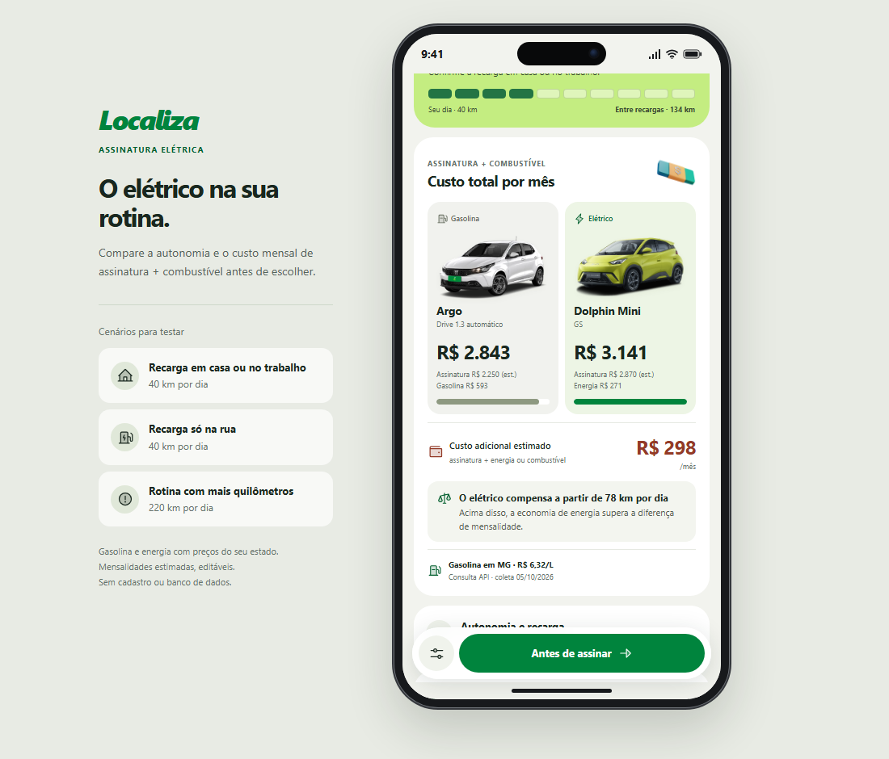

# O elétrico na sua rotina

Simulador que mostra ao cliente se um carro elétrico por assinatura **compensa ou não** financeiramente na rotina dele, somando a mensalidade ao gasto com energia ou combustível, com os preços do estado onde ele mora.

| Sua rotina e região | Seu cenário |
| :---: | :---: |
|  |  |

## O contexto

Este projeto nasceu em um hackathon da Localiza. O case pedia uma solução para **aumentar a taxa de conversão dos carros elétricos no serviço de assinatura**.

## A ideia

Na nossa pesquisa, constatamos que mais de 70% das pessoas colocam o fator financeiro em primeiro lugar na hora de decidir. A dúvida que trava a conversão é simples: *"o elétrico vale a pena para o quanto eu rodo?"*

Por isso criamos uma calculadora. O cliente informa quantos quilômetros roda por dia, onde pode recarregar e o CEP, e o simulador compara o custo mensal total de um elétrico com o de um carro a gasolina equivalente:

```
custo mensal = assinatura + energia (ou combustível) para os km rodados
```

## O princípio: vender o melhor para o cliente

Um dos valores da Localiza é *"o cliente é nossa paixão"*. Levamos isso para o produto: o simulador não existe para empurrar o elétrico, e sim para indicar a melhor opção para cada pessoa.

Na prática, isso significa que ele diz com a mesma clareza quando o elétrico **não** compensa. Com os valores padrão do protótipo, quem roda 40 km por dia em Minas Gerais gasta menos com energia do que gastaria com gasolina, mas a diferença de mensalidade pesa mais e o total do elétrico sai cerca de R$ 300 mais caro por mês. O simulador mostra esse custo adicional sem disfarçar e informa o **ponto de equilíbrio**: nesse exemplo, o elétrico passa a compensar a partir de 78 km por dia.

A aposta é que um cliente que escolhe bem informado sai mais satisfeito, e cliente satisfeito renova e indica. A conversão que buscamos é a que gera recorrência.

## O que o simulador faz

- Compara o custo mensal total: assinatura + energia ou gasolina.
- Calcula o ponto de equilíbrio: a partir de quantos km por dia o elétrico compensa.
- Identifica o estado do cliente pelo CEP ou pela localização do aparelho e aplica os preços de gasolina e de energia desse estado.
- Avalia se o trajeto diário cabe na autonomia, com margem de segurança.
- Considera recarga em casa/trabalho ou em pontos públicos, com tarifas diferentes.
- Compara só com hatches automáticos de porte próximo, já que todo elétrico é automático: BYD Dolphin Mini × Fiat Argo Drive 1.3 CVT e BYD Dolphin × Chevrolet Onix LTZ 1.0 Turbo AT.
- Permite trocar mensalidades e tarifas pelos valores da cotação real do cliente.
- Traz um checklist do que confirmar antes de assinar e um resumo copiável.

## APIs e fontes de dados

| Dado | Fonte | Como é usado |
| --- | --- | --- |
| Gasolina por estado | [Combustível API](https://combustivelapi.com.br/) | Consulta ao vivo; sem resposta, usa a última coleta salva |
| CEP → cidade e estado | [BrasilAPI](https://brasilapi.com.br/) | Consulta ao vivo; se estiver fora do ar, o [ViaCEP](https://viacep.com.br/) assume |
| Localização → cidade e estado | [OpenStreetMap Nominatim](https://nominatim.openstreetmap.org/) | Consulta ao vivo, com as coordenadas arredondadas para cerca de 1 km |
| Tarifa residencial de energia | [Dados abertos da ANEEL](https://dadosabertos.aneel.gov.br/dataset/tarifas-distribuidoras-energia-eletrica) | Retrato gerado por script (a API da ANEEL não aceita chamadas diretas do navegador) |
| Gasolina, reserva por estado | ANP, levantamento semanal de preços | Estimativa quando a API não traz o estado |

Todas as chamadas passam por um cliente HTTP único, com tempo limite e nova tentativa em falhas passageiras. Nenhuma das APIs exige chave, e o app não tem backend nem banco de dados.

## Como rodar

O app usa módulos JavaScript, que o navegador só carrega por HTTP. Na pasta do projeto:

```bash
python3 -m http.server 8000
```

Depois, acesse `http://localhost:8000`. Qualquer servidor de arquivos estáticos serve, inclusive o GitHub Pages.

### Testes

Os testes cobrem o cálculo, o cliente HTTP, o cache e a leitura de cada API. Rodam com o Node.js 20 ou mais recente, sem dependências:

```bash
npm test
```

### Atualizar as tarifas de energia

```bash
npm run update:energy
```

O script consulta a ANEEL e regrava `src/data/energy-tariffs.js`. Ele falha, em vez de gravar um arquivo incompleto, se faltar a tarifa de alguma distribuidora.

## Estrutura

```
├── index.html
├── assets/                 Estilos e imagens
├── src/
│   ├── config.js           Endereços das APIs, tempos limite e cache
│   ├── core/               Cálculo puro: simulação, ponto de equilíbrio, energia, formatação
│   ├── data/               Veículos, premissas, estados e preços de reserva
│   ├── services/           Cliente HTTP, cache e clientes das APIs
│   └── ui/                 Interface: estado, telas e eventos
├── scripts/                Atualização das tarifas da ANEEL
├── tests/                  Testes automatizados
└── docs/                   Capturas de tela
```

## Como o cálculo funciona

| Etapa | Cálculo |
| --- | --- |
| Km por mês | km por dia × dias de uso |
| Autonomia útil entre recargas | autonomia nominal × 80% (uso real) × 60% (bateria entre 20% e 80%) |
| Energia em casa | tarifa residencial do estado (ANEEL) × 1,3 (impostos estimados) |
| Custo de energia | km por mês × consumo (kWh/km) ÷ 90% (perdas de recarga) × tarifa |
| Custo de gasolina | km por mês ÷ consumo urbano (km/L) × preço do litro no estado |
| Custo total | assinatura + energia ou gasolina |
| Ponto de equilíbrio | diferença de mensalidade ÷ economia por km ÷ dias de uso |

A rotina é considerada compatível quando o trajeto diário, com 30% de margem, cabe na autonomia útil.

As premissas ficam em `src/data/assumptions.js`, e as mensalidades e tarifas podem ser ajustadas na própria interface.

## Limites

Os valores são estimativas, e alguns pedem atenção:

- **Mensalidades.** As dos elétricos seguem preços "a partir de" divulgados para a Localiza Meoo. A do Onix vem de uma oferta de mercado que não é da Localiza, e a do Argo CVT é uma estimativa proporcional ao preço de tabela. Todas devem ser trocadas pela cotação real; a origem de cada uma está em `src/data/cars.js`.
- **Impostos da energia.** A ANEEL homologa a tarifa sem impostos. Os 30% somados aproximam ICMS e PIS/Cofins com um número único para o país, e as alíquotas reais variam por estado. A bandeira tarifária não entra.
- **Tarifa por estado.** Em estados com mais de uma distribuidora de grande porte, o valor é a média entre elas.
- **Recarga pública.** O preço por kWh é um valor de exemplo.

A comparação não inclui instalação de carregador nem taxas extras. O protótipo não garante autonomia, não verifica disponibilidade de carregadores e não realiza contratação.

## Créditos

- Consumo dos veículos a gasolina: PBE Veicular/Inmetro.
- Ícones: [Phosphor Duotone](https://phosphoricons.com/) (MIT) e [3dicons](https://old.3dicons.co/) (CC0). Detalhes em [THIRD_PARTY_NOTICES.md](THIRD_PARTY_NOTICES.md).
- Geolocalização: © colaboradores do [OpenStreetMap](https://www.openstreetmap.org/copyright).
- Imagens e marcas de veículos pertencem aos respectivos titulares.

Protótipo de hackathon, não oficial e sem vínculo comercial com a Localiza ou com as montadoras.
